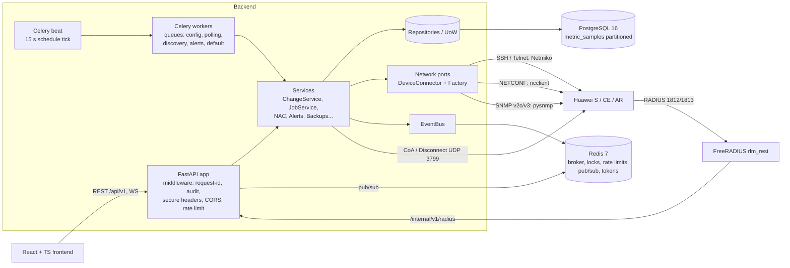
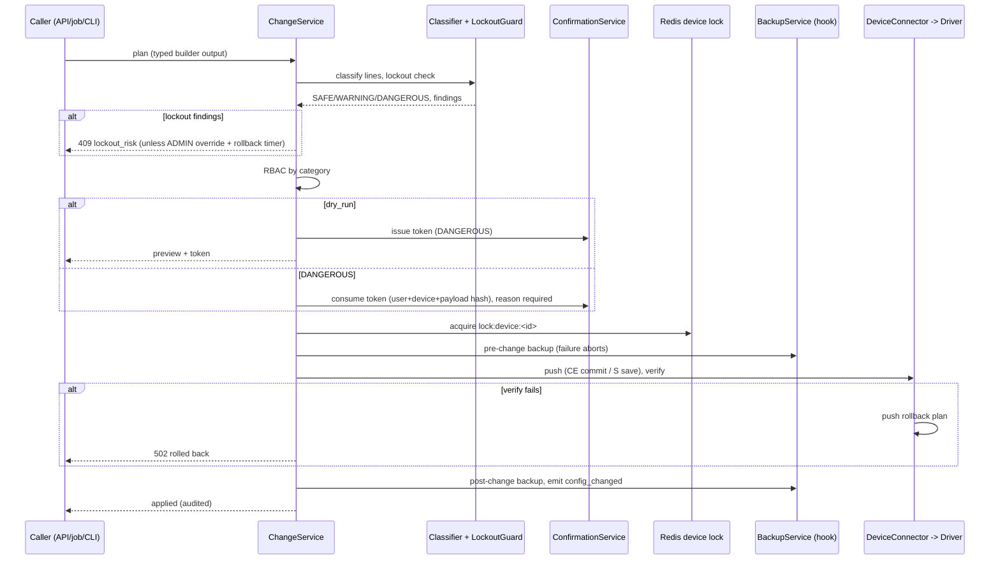
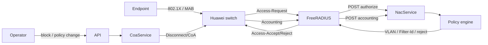

# Architecture

Clean Architecture with ports and adapters. Domain logic (`app/domain`) is framework-free and
unit-tested without a database or network. Dependency rule:
`api -> services -> (repositories, network ports)`; network drivers implement ports; models and
schemas never import the API; the API never imports drivers.

## Components

## Layers and packages

| Package | Responsibility |
|---|---|
| `app/api` | Routers, dependencies (auth, RBAC `require()`, rate limits), problem+json, WebSockets, internal RADIUS callbacks |
| `app/services` | Use cases: devices, credentials, commands, changes, L2/ACL/routing features, jobs, backups, monitoring, alerts, discovery, NAC, CoA |
| `app/domain` | Pure logic: command classifier/sanitizer/lockout guard, VLAN/MAC/interface value objects, ACL model, L2 anomaly heuristics, metrics math, alert evaluation, config text (hash/diff/restore), NAC policy engine + profiling |
| `app/network` | `DeviceDriver` port, factory with per-device session cap, Redis config lock, host-key pinning, Netmiko SSH/Telnet, ncclient NETCONF + ModelRegistry, pysnmp client/collectors, typed CLI/NETCONF builders, parsers |
| `app/repositories` | Generic repository (whitelisted filter/sort/paging) and Unit of Work |
| `app/models` | SQLAlchemy 2 typed models (portable types: INET/JSONB on PostgreSQL) |
| `app/workers` | Celery app, per-process runtime (event loop + container), tasks, DB-backed schedule tick |
| `app/cli` | Typer CLI on the same services (runs as `CLI_USERNAME`) |

## Guarded change pipeline

Every configuration change - API call, bulk job, restore, NAC provisioning - goes through
`ChangeService.apply`:

## Device access

- `DeviceConnector` resolves the credential (vault), verifies the SSH host key (TOFU, strict
  afterwards), builds `ConnectionParams` and runs the blocking driver in a worker thread
  (`anyio.to_thread`) under a per-device semaphore (default 2 sessions, protects VTY lines).
- Drivers: `huawei` (S/AR) and `huawei_vrpv8` (CE, two-stage commit) via Netmiko; Telnet via
  `huawei_telnet` with a security warning on every result; NETCONF via ncclient with a
  capability-driven `ModelRegistry`; SNMP via pysnmp (asyncio) for monitoring/identification.
- Huawei error markers (`Error:`, `Unrecognized command`, ...) fail operations explicitly;
  library exceptions map to `DeviceUnreachable`, `DeviceAuthFailed`, `DeviceTimeout`,
  `CommandRejected`, `HostKeyMismatch` without credentials in messages.

## Jobs

`POST /api/v1/jobs` -> 202 + `Location`. `JobRunner` claims the job atomically, fans out per
device with a concurrency cap, honours stop-on-failure and cancellation, records
`job_device_results`, and publishes progress on `events:job:<id>` (WebSocket fan-out). Bulk
DANGEROUS changes use a job-level confirmation token from a dry-run job.

## Data

- PostgreSQL with Alembic migrations only; append-only `audit_logs` (trigger); `metric_samples`
  partitioned by month (DEFAULT partition + maintenance task creating partitions ahead and
  enforcing retention).
- Redis: Celery broker/results, rate-limit counters, jti denylist, confirmation tokens, WS
  tickets, device locks, alert state, pub/sub.

## NAC

See `docs/adr/0001-radius-architecture.md`. FreeRADIUS terminates RADIUS/EAP and calls
`/internal/v1/radius/authorize|accounting`; the declarative policy engine decides (first match by
ascending priority, mandatory default quarantine), decisions are audited, CoA re-authorizes or
disconnects sessions, and switch-side configuration is generated and deployed through jobs.

